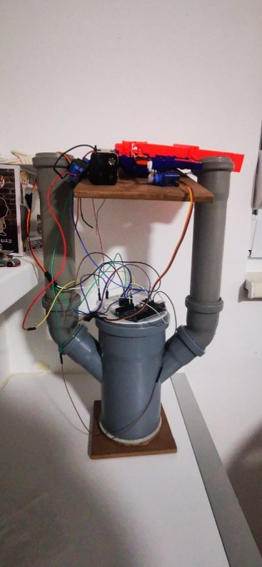
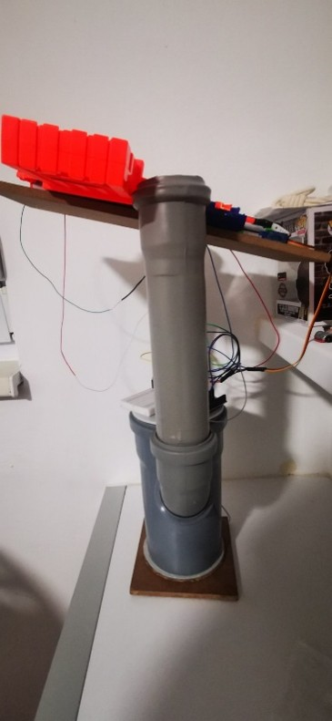
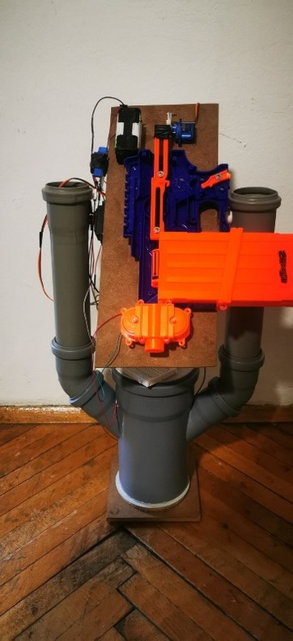
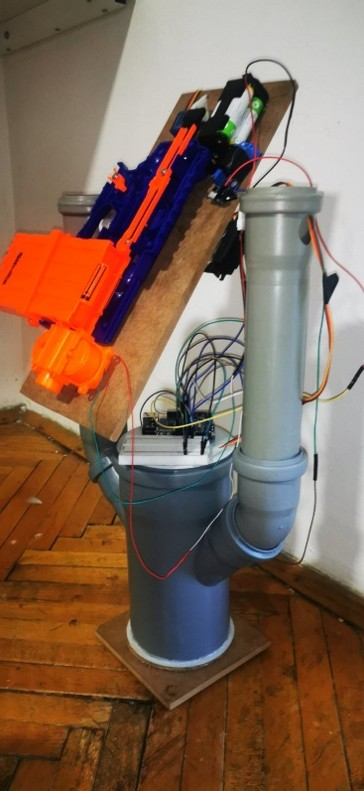
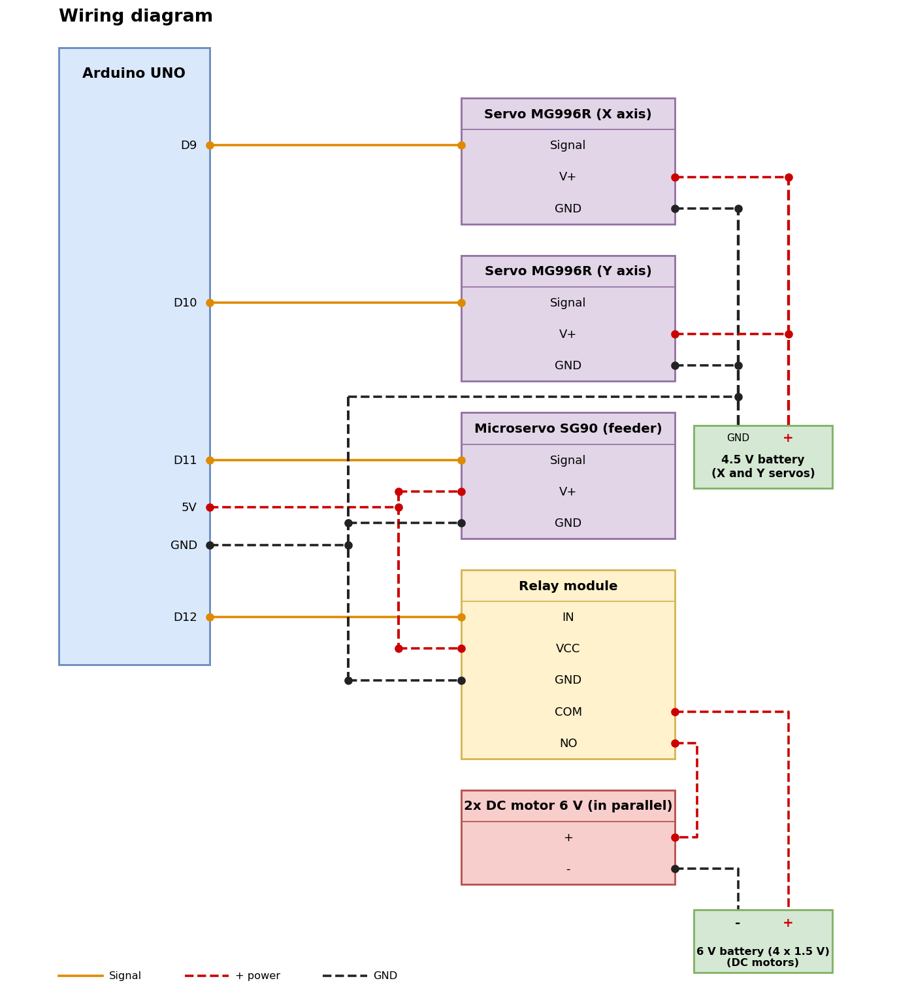
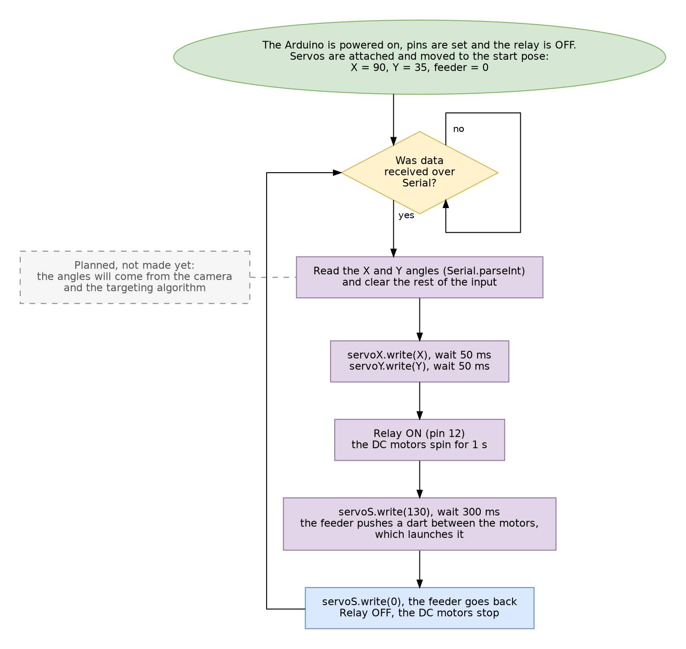

# Anti-Balloon System: Arduino Dart Launcher

A two-axis (gimbal-style) turret built on an Arduino UNO that aims and launches foam (NERF) darts **at balloons**. Two MG996R servos give free rotation around the X and Y axes, and a pair of counter-rotating DC motors, switched by a relay, fires darts that a small servo pushes out of a magazine. The long-term goal is for the turret to track a target with a camera and fire on its own, but **this is not implemented yet** (see [Project status](#project-status)).

> **Faculty of Computer Science and Engineering - Skopje**  
> Course project for **Robotics Basics** (Основи на роботиката)  
> **Students:** Stefan Todoroski, Stefan Sekulov, Ognen Galeski  

> [WARNING]
> **Work in progress.** The hardware is built and the mechanics work, but the project is **not autonomous yet**: there is **no camera** and **no algorithm that calculates where to aim**. See [Project status](#project-status).

---

## Table of contents

1. [Project status](#project-status)
2. [Goal](#goal)
3. [Hardware](#hardware)
4. [Photos](#photos)
5. [Wiring](#wiring)
6. [How it works](#how-it-works)
7. [Software design](#software-design)
8. [How to run it](#how-to-run-it)
9. [Testing](#testing)
10. [Limitations and future work](#limitations-and-future-work)

---

## Project status

| Part | Status |
|------|--------|
| Mechanical build (body, X/Y gimbal, launcher, magazine, feeder) | Done |
| X and Y servo control | Works |
| Launcher (relay, DC motors) and dart feeder (SG90) | Works |
| Test sketch: type X and Y angles in the Serial Monitor, the robot aims and fires one dart | Written, used to test all components together |
| Camera (visual sensor) | **Not added yet** |
| Algorithm that finds the target and calculates the X/Y angles to shoot at | **Not made yet** |
| Autonomous aiming and firing | **Not possible yet** (depends on the two items above) |

For now the turret can only be aimed with angles that are typed by hand in the Serial Monitor, so the current version demonstrates the hardware, not automatic targeting.

---

## Goal

The goal is to design and build a robot that **shoots balloons**: it moves freely around two axes and launches foam darts in a chosen direction to pop a balloon. The intended use is autonomous aiming and firing based on information from a visual sensor (camera), where the camera finds the balloon and the robot aims at it and fires. That final part is **still to be done**; at this stage the project covers the robot itself and its control from code.

The project covers these robotics and embedded concepts:

- **Servo control** for precise angular positioning (`Servo` library, `servo.write(angle)`)
- **A two-axis gimbal mechanism** with independent rotation around X and Y
- **Switching a high-current load with a relay**, driven from a digital pin of the Arduino
- **Counter-rotating DC motors** working as a flywheel launcher (one turns CW, the other CCW)
- **A mechanical feeding mechanism**: a servo with a plastic arm pushes darts from the magazine into the launcher
- **Mechanical design and balancing** of a top-heavy structure

---

## Hardware

| Component | Qty | Purpose |
|-----------|-----|---------|
| Arduino UNO R3 | 1 | Main controller board |
| Breadboard | 1 | Mounting the connections |
| Servo MG996R | 2 | Rotation around the X axis and the Y axis (high torque, carries the whole platform) |
| Servo SG90 (micro) | 1 | Pushes darts from the magazine into the launcher |
| 5V-30V relay module | 1 | Switches power to the launcher DC motors on a signal from the Arduino |
| Micro DC motor, 6 V, 7300 RPM | 2 | Launcher flywheels, mounted close together and spinning in opposite directions |
| NERF darts and magazine | 10 darts | Projectiles |
| Wooden board, PVC pipes, silicone glue | - | Platform, body and joints of the robot |
| 6 V battery pack (4 x 1.5 V) | 1 | External power for the two launcher DC motors, switched by the relay |
| 4.5 V battery pack | 1 | External power for the two MG996R servos (X and Y axes) |
| Jumper wires, USB cable | - | Connections, uploading the code and powering the board |

---

## Photos & Video

### Photo

  
  
  
  

### Video

Demo of the robot in use: [YouTube](https://www.youtube.com/watch?v=SC__Qld-9no)

---

## Wiring

The robot uses three separate power sources:

- **Arduino (USB / 5 V pin):** powers the SG90 feeder servo and the relay module directly.
- **4.5 V battery pack:** powers the two MG996R servos (X and Y axes). Its GND is connected to the Arduino GND, so the servo signals have a common reference.
- **6 V battery pack (4 x 1.5 V):** powers the two DC motors. The relay switches its + line, so the motors run only when the Arduino activates the relay on pin 12. The motors are connected in parallel.

The high-current parts (two MG996R servos and the DC motors) have their own batteries so that they do not load the Arduino's 5 V supply.

### Pin map

| Arduino pin | Component | Mode |
|-------------|-----------|------|
| 9 | Servo MG996R (X axis) | PWM signal |
| 10 | Servo MG996R (Y axis) | PWM signal |
| 11 | Servo SG90 (dart pusher) | PWM signal |
| 12 | Relay module (launcher motors) | `OUTPUT` |

---

## How it works

**Mechanics**

- **X axis:** the gear of one MG996R servo is attached to an add-on fixed to a separate platform, while the servo body is glued to the body of the robot. When the servo turns, the whole body turns with it.
- **Y axis:** on one side of the firing platform a second MG996R turns the platform through an add-on fixed to its side. On the other side, a pipe rotates freely, so the platform can tilt smoothly.
- **Launcher:** two DC motors are glued close together on a wooden board, and the dart passes through the gap between them. One motor turns CW and the other CCW, so the dart is pinched and shot out at high speed.
- **Magazine and feeder:** the magazine sits behind the motors and holds 10 NERF darts. The SG90 servo, with a plastic piece glued to its head, pushes a dart forward between the two spinning motors.

**Control flow (test sketch)**

1. **Start:** the pins are set, the relay is OFF, and the servos move to their start pose (X = 90°, Y = 35°, feeder = 0°).
2. **Wait for input:** the program waits until two numbers, the X and Y angles, are typed in the Serial Monitor. This replaces the camera and targeting algorithm, which do not exist yet.
3. **Aim:** the X servo and then the Y servo move to the typed angles (50 ms pause after each).
4. **Spin up:** the relay switches ON and the two DC motors run for 1 second.
5. **Feed:** the SG90 servo moves to 130° for 300 ms, pushing a dart between the running motors, which launches it.
6. **Return:** the feeder goes back to 0°, the relay switches OFF and the motors stop. The program waits for the next input.

### Program flow

The flow of the current test sketch. The dashed box marks the part that is still to be made.

---

## Software design

The program is an Arduino sketch (the source file is not included in this repository). Design notes:

- It uses only the standard `Servo` library; the X servo, the Y servo and the feeder servo are separate `Servo` objects.
- The two angles are read from the Serial Monitor with `Serial.parseInt()` (9600 baud), and the rest of the input is cleared before the shot.
- One input produces exactly one shot, so the robot does not fire on its own.
- The relay isolates the launcher motors (and their 6 V battery) from the Arduino pin, so the board only has to send a logic signal.
- The dart-feeding servo is set to 130° to push a dart into the running motors, then returns to 0°.
- The working range of the X axis is the full 0° to 180°, and the Y axis is limited to 0° to 70°.

---

## How to run it

1. Build the robot and the circuit as shown in the [wiring diagram](#wiring).
2. Install the [Arduino IDE](https://www.arduino.cc/en/software).
3. Open the sketch in the Arduino IDE.
4. Select **Tools → Board → Arduino UNO** and the correct port.
5. Click **Upload**.
6. Connect the 4.5 V pack (X/Y servos) and the 6 V pack (DC motors) and load the magazine with darts.
7. Open the **Serial Monitor**, set it to **9600 baud**, type the X and Y angles separated by a space (for example `90 35`) and send them. The robot aims and fires one dart.

Only the standard `Servo` library is needed.

---

## Testing

The two rotation axes were first tested on their own and worked correctly. Then the launcher was tested, and it went through several rounds of adjustment.

| Scenario | Result |
|----------|--------|
| X and Y axis rotation | Both axes rotate as intended once they were balanced separately |
| Early balancing test | The robot lost balance and fell several times, so X and Y were fixed with separate solutions |
| Feeder servo without the extension | The SG90 did not have enough torque to launch the darts |
| Feeder with a plastic extension, set at 130° | The dart is pulled in between the running DC motors and launched at high speed |

The test sketch checks the whole chain in one go: two angles are typed in the Serial Monitor, the servos move to them, the DC motors turn on, the feeder servo goes to 130° and pushes a projectile out, then the feeder returns and the motors turn off.

Only the hardware and its manual control have been tested. Automatic target detection and aiming could not be tested, because the camera and the targeting algorithm do not exist yet.

Total time spent: 3 to 4 weeks of continuous work, 6 to 8 hours a day.

---

## Limitations and future work

**Limitations**

- **The robot is not autonomous yet:** there is no camera, and there is no algorithm that calculates where to shoot, so the X/Y angles have to be set by hand in the code.
- The SG90 feeder servo is weak and could be replaced with an MG996R, the same servo type used for the two axes.
- The axes do not rotate a full 360°: the X axis covers 0° to 180° and the Y axis only 0° to 70°.
- There is no mechanism for automatically refilling the magazine.

**Strengths:** sturdy build, can carry a heavier load, accurate and precise movement and firing, fast torque, and darts launched at high speed.

**Future work (the main remaining work on this project)**

- Add a visual sensor (camera), which the project does not have yet.
- Optimise the source code to read data from the camera over the serial bus.
- Add an algorithm that recognises objects and calculates their coordinates, and from them the X and Y servo angles to shoot at. This is not made yet.
- Add an algorithm that predicts the position of the tracked object from previously measured coordinates.
